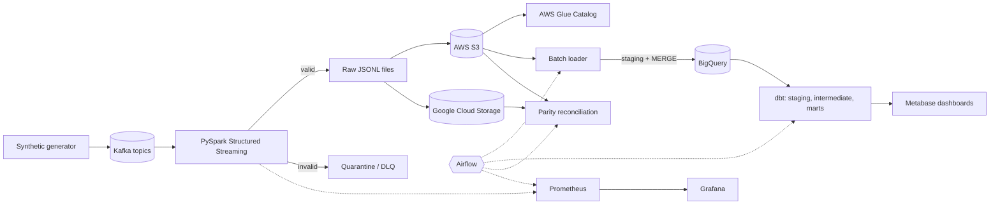
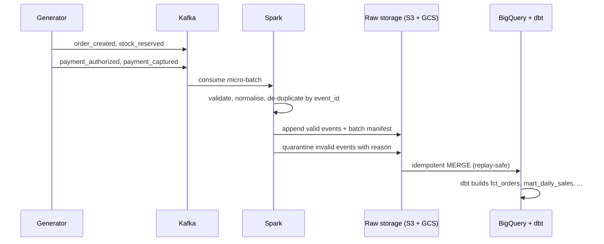
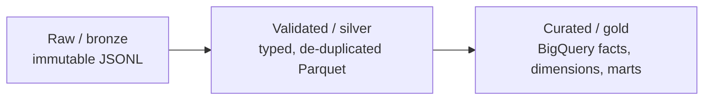

# Multi-Cloud E-Commerce Data Platform

[](https://github.com/AAliKKhan/multicloud-ecommerce-data-platform/actions/workflows/ci.yml)


A production-style **data engineering platform** for a fictional online shop.
It ingests order, payment, customer and inventory events, streams them
through Kafka, validates and de-duplicates them with Spark, archives the raw
data in **AWS S3** and **Google Cloud Storage**, loads trusted tables into
**BigQuery**, models them with **dbt**, orchestrates everything with
**Airflow**, and shows business and pipeline health in dashboards.

> **Synthetic data only.** No real customers, payments or card data are ever
> used. Cloud deployment is opt-in and the whole pipeline is designed to run
> locally without any cloud account.

## What it does

1. **Generates** realistic fictional shop activity (customers, products,
   orders, payments, stock movements), including deliberately bad data:
   duplicates, malformed, late and out-of-order events.
2. **Streams** versioned JSON events through Kafka topics.
3. **Validates** every event, quarantines bad ones with a reason, and
   removes duplicates (PySpark Structured Streaming).
4. **Archives** raw events in partitioned files on two clouds, with batch
   manifests so the two copies can be reconciled.
5. **Loads** clean data into BigQuery with idempotent `MERGE`, so replaying a
   batch never double-counts revenue.
6. **Models** staging, intermediate and mart tables with dbt (tests + docs).
7. **Orchestrates** loads, backfills, quality checks and reconciliation with
   Airflow.
8. **Monitors** throughput, quarantine rate, freshness and cross-cloud parity
   with Prometheus and Grafana, and exposes business metrics in a BI
   dashboard.

## Architecture



### Life of an order



### Data layers



## Tech stack

| Layer | Technology | Role | Status |
|---|---|---|---|
| Language |  | Generator, validation, loaders, tests | In use |
| Packaging |     | Locked deps, lint, types, tests | In use |
| Contracts |  | Typed config and event schemas | In use |
| Local warehouse |  | Local stand-in for BigQuery (same loader, same dbt models) | In use |
| CI |  | Lint, types, tests on every push | In use |
| Broker |  | Durable event transport (single-node KRaft) + Kafka UI | In use |
| Stream processing |  | Validate, de-duplicate, land events (Structured Streaming, one container) | In use |
| Object storage |    | Raw archive on two clouds; local directories stand in today | Adapters built, cloud unverified |
| Catalog |  | Metadata for the S3 copy | Planned |
| Warehouse |  | Analytical storage | Client built, unverified |
| Transformations |  | 19 models, 85+ tests; runs on DuckDB, BigQuery SQL syntax-checked | In use |
| Orchestration |  | Scheduling, backfills | Planned |
| Infrastructure |  | AWS + GCP buckets, datasets, IAM, Glue; validated in CI | Validated, never applied |
| Local stack |  | Compose: Kafka, Kafka UI, Spark; Airflow, monitoring next | Partly built |
| Monitoring |   | Exporter, alert rules and dashboard JSON written; the services themselves not run yet | Configs tested, services not run |
| BI |  | Static HTML dashboard today; Metabase planned | Stand-in built |

## Events at a glance

| Topic | Key | Event types |
|---|---|---|
| `commerce.orders` | `order_id` | `order_created`, `order_updated`, `order_cancelled` |
| `commerce.payments` | `payment_id` | `payment_authorized`, `payment_captured`, `payment_failed`, `payment_refunded` |
| `commerce.inventory` | `product_id:location_id` | `stock_received`, `stock_reserved`, `stock_adjusted` |
| `commerce.customers` | `customer_id` | `customer_created`, `customer_updated` |

Every event shares one envelope (`event_id`, `event_type`, `schema_version`,
`event_time`, `producer`, `correlation_id`, `payload`). See the
[data contracts](docs/04-DATA-CONTRACTS-AND-TRANSFORMATIONS.md).

## Project status

Built milestone by milestone. Nothing is claimed as working until its
acceptance test passes. Python-only milestones come first; the Docker-based
services are integrated last.

| Milestone | Scope | Status |
|---|---|---|
| M0 | Repository, config validation, ADRs, CI | Done |
| M1 | Seeded synthetic commerce generator and event contracts | Done |
| M2 | Kafka producer and local broker (Docker) | Done (single-node KRaft; integration-tested against the real broker) |
| M3 | Spark streaming validation, dedup, quarantine | Done (single-node, `local[2]`; crash/restart and no-silent-loss integration-tested; throughput not benchmarked) |
| M4 | Storage abstraction, manifests, cross-cloud parity | Done (cloud adapters unverified) |
| M5 | Terraform for AWS and GCP (validated, never applied) | Done (`plan`/`apply` unverified) |
| M6 | Idempotent warehouse loader (`MERGE`) | Done (DuckDB verified, BigQuery unverified) |
| M7 | dbt staging, intermediate and mart models | Done (DuckDB verified, BigQuery syntax-checked only) |
| M8 | Airflow DAGs | Planned |
| M9 | Data quality and observability | Partly done: quality suite, quarantine tool, metrics, alert rules and Grafana JSON written and tested; Prometheus/Grafana not run (Docker) |
| M10 | BI dashboard and portfolio polish | Partly done: static HTML dashboard (stand-in for Metabase); Metabase, screenshots from real services and demo recording pending |

Cloud code (S3, GCS, BigQuery) is developed behind interfaces and tested with
`moto` and fakes. It stays marked **unverified** until run against real accounts.

## Quick start (no Docker, no cloud)

Requires [uv](https://docs.astral.sh/uv/), which installs Python 3.12 for you.

```bash
uv sync                  # create .venv and install locked dependencies
cp .env.example .env     # optional; defaults work for local mode
uv run pytest            # run the tests
uv run ruff check .      # lint
uv run ruff format --check .
uv run mypy              # type check
```

Python is pinned to 3.12 (`>=3.11,<3.13`) because PySpark, Airflow and
dbt-bigquery do not reliably support newer interpreters.

## Generate synthetic data

```bash
uv run ecomm-generate --out data/fixtures/demo --orders 200 --seed 42
```

This writes four files (git-ignored under `data/`):

| File | Content |
|---|---|
| `events.jsonl` | The arrival stream: `seq`, `arrival_time`, `topic`, `key` and the raw message `value` |
| `labels.jsonl` | Ground truth per message (`duplicate`, `late`, `out_of_order`, `malformed`) for tests and demos only |
| `products.jsonl` | Reference product catalogue |
| `summary.json` | Counts by event type, topic and fault |

The generator is fully deterministic for a given `--seed`. Fault rates are
adjustable (`--malformed-rate`, `--late-rate`, `--out-of-order-rate`,
`--duplicate-rate`). Without `--out` it streams records to stdout, paced by
`--rate` events per second. Every well-formed message passes `parse_event`
(the same validator the Spark job will use); every malformed one is rejected
with a stable error code.

## Run the whole batch pipeline (no Docker, no cloud)

```bash
uv sync --all-extras
uv run ecomm-demo --out data/demo --orders 300 --days 3   # generate, ingest, land, verify parity, load
cp data/demo/products.csv dbt/seeds/products.csv
DBT_DUCKDB_PATH=data/demo/warehouse.duckdb \
  uv run dbt build --project-dir dbt --profiles-dir dbt --target duckdb
```

In this mode two local directories stand in for S3 and GCS, and DuckDB stands in
for BigQuery. See the [operations guide](docs/operations.md) and the
[data dictionary](docs/data-dictionary.md).

## What has been verified

| Area | How | Result |
|---|---|---|
| Contracts, generator, ingest, manifests, retries, parity | 200+ unit tests | Passing |
| Dual-cloud commit: partial failure, retry, corruption | Fault-injecting stores | Passing |
| S3 adapter | `moto` | Passing (not real AWS) |
| GCS adapter | Fake client | Passing (not real GCS) |
| Idempotent load and replay | DuckDB | Replay inserts 0 rows, totals unchanged |
| dbt models and tests | `dbt build` on DuckDB | 0 errors; warnings flag orphans from quarantined events |
| Business metrics | Independent Python re-computation vs. marts | Match |
| BigQuery SQL | Offline compile + sqlglot parse | Syntax only; **not run on BigQuery** |
| Terraform (AWS, GCP) | `fmt`, `validate` and static security tests in CI | Passing; **never planned or applied** |
| Spark streaming job | Logic unit tests + real container: crash after commit, restart, rerun; counts equal the reference ingest; no event written twice; per-batch check against Spark's planned offsets | Passing; full demo: 1,490 of 1,490 Kafka messages accounted for |
| Kafka producer | 31 unit tests (fake + real client with no broker) and 8 integration tests on the real broker | Passing: delivery, keys to partitions, per-key order, headers, failures visible |
| Data-quality suite | 17 checks, healthy and deliberately broken runs, on real dbt output | Passing |
| Metrics, alert rules, Grafana JSON | Exporter tests; alerts evaluated in a simulated failure | Passing; **Prometheus/Grafana not run** |
| Business dashboard | Figures compared with the independent oracle; rendered in a browser | Matches |

Airflow, the running Prometheus/Grafana stack and Metabase are not built yet. No
cloud resource has been created and no cloud account is required.

## Kafka (Docker)

```bash
docker compose up -d kafka kafka-init kafka-ui   # broker, topics, UI at http://127.0.0.1:8080
uv sync --extra kafka
uv run ecomm-kafka health
uv run ecomm-kafka produce --orders 200 --seed 42 --rate 50
uv run ecomm-kafka consume --topic orders --max 5
```

A single-node broker: a development topology, not a fault-tolerant cluster.
Details, topics and limits in [docs/docker.md](docs/docker.md).

## Spark streaming (Docker)

```bash
docker compose --profile spark build spark       # first time: large download
docker compose --profile spark run --rm spark --dedup-retention-hours 96   # drain Kafka, then exit
uv run ecomm-load --demo-dir data/spark          # then load, dbt, quality, dashboard
```

Kafka to validated, de-duplicated raw files in two destinations, with manifests, a quarantine
and per-batch statistics; restarts never double count. Spark silently drops rows older than
its watermark, so every batch is verified against Spark's own planned offsets and fails
loudly instead (a real run lost 15 messages before this check existed). Details, the
retention rule and measured performance: [docs/spark.md](docs/spark.md).

## Quality, metrics and dashboard

```bash
uv run ecomm-quality    --demo-dir data/demo   # data-quality checks (exit 1 on FAIL)
uv run ecomm-quarantine --demo-dir data/demo   # inspect rejected events
uv run ecomm-metrics    --demo-dir data/demo --serve 9108   # Prometheus /metrics
uv run ecomm-report     --demo-dir data/demo   # data/demo/dashboard.html
```

Details in [observability and quality](docs/observability-and-quality.md).

## Design principles

- **At-least-once delivery plus idempotent writes and deduplication.** The
  project does **not** claim exactly-once delivery or automatic cross-cloud
  failover.
- Raw events are immutable and are the replay source.
- Every event carries an ID, schema version, event time and ingestion time.
- Duplicate, late, malformed and out-of-order events are handled explicitly.
- Secrets never live in source control.

## Documentation

- Full specification: [`docs/`](docs/README.md)
  1. [Product and system requirements](docs/01-PRODUCT-AND-SYSTEM-REQUIREMENTS.md)
  2. [Architecture and data flow](docs/02-ARCHITECTURE-AND-DATA-FLOW.md)
  3. [Tech stack and infrastructure](docs/03-TECH-STACK-AND-INFRASTRUCTURE.md)
  4. [Data contracts and transformations](docs/04-DATA-CONTRACTS-AND-TRANSFORMATIONS.md)
  5. [Implementation plan](docs/05-IMPLEMENTATION-PLAN-AND-AGENT-INSTRUCTIONS.md)
  6. [Operations, security and cost](docs/06-OPERATIONS-SECURITY-AND-COST.md)
  7. [Portfolio and demo](docs/07-PORTFOLIO-AND-DEMO.md)
- [Data dictionary and metric definitions](docs/data-dictionary.md)
- [Operations guide and runbooks](docs/operations.md)
- [Infrastructure: Terraform, deploy and teardown](docs/infrastructure.md)
- [Data quality, observability and dashboard](docs/observability-and-quality.md)
- [Docker stack: Kafka, topics, producer](docs/docker.md)
- [Spark streaming job](docs/spark.md)
- Architecture decisions: [`docs/decisions/`](docs/decisions)

## License

MIT
